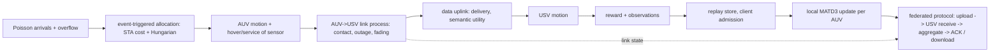

# System Architecture

## Network
N static sensors (finite FIFO buffers, Poisson traffic) - M AUVs (collect, carry, upload) - **exactly one USV** (surface relay + federated server).
AUV-USV is an intermittent acoustic link (range gate + Gilbert-Elliott outages + per-step Rayleigh fading). Nothing assumes continuous or simultaneous contact.

## Data flow (one environment step; event order is fixed)

## Information available
| Phase | Used by | Information |
|---|---|---|
| Execution | actors | local observation only: own position, goal vector, neighbours' positions (refreshed only while the AUV-USV link is up; age exposed), onboard fill, link flag, saturation count |
| Training | critics | simulator global state + joint actions (CTDE). **Training is centralised-critic, not fully decentralised.** |
| Federation | USV | only actor parameter deltas + measured window statistics (no raw data). No privacy mechanism or threat model: **no privacy claim**. |

## Federation policy
Actors are federated; each AUV keeps its own twin critics, replay buffer, optimisers and counters (critic input/output semantics are agent-specific, so critics are not averaged).
Versions tracked: client `base_version`, `local_version`, server `version`; every receive/reject/aggregate decision is logged.

## Module map
`environment/` physical world and env API | `communication/` acoustic link, link process, transfers, scheduler | `semantic/` packets, VoI, utility |
`allocation/` prediction, capacity, cost, allocator | `agents/` MATD3 | `federated/` client, USV server, aggregation, relevance, protocol |
`baselines/` registry (+MAPPO, reference controller) | `training/` trainer, local training, federation builder, checkpoints | `evaluation/` metrics, evaluator, statistics, reports.
